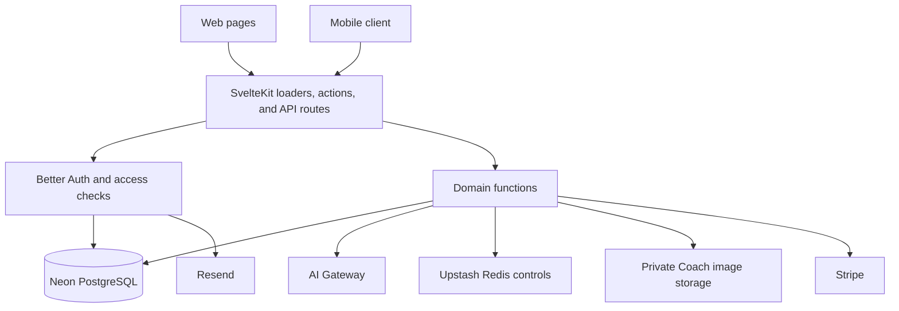

# Architecture

Reviewed against the working tree on 2026-11-03. This document describes the main boundaries; the linked code owns exact behavior and configuration.

## Application structure

Free AP Practice is a Bun/TypeScript application built with SvelteKit, Svelte 5, and Tailwind CSS, deployed to Vercel. Web pages and mobile HTTP APIs share domain functions. Neon PostgreSQL is the application database, accessed through Drizzle and the Neon HTTP adapter.

| Location | Responsibility |
| --- | --- |
| `src/routes` | Marketing pages, authenticated product pages, loaders, actions, APIs, and cron/webhook entry points |
| `src/lib/auth` | Better Auth, session helpers, organization membership, classroom eligibility, and mobile sign-in handoff |
| `src/lib/catalog` | Course data, source provenance, practice pages, and mobile catalog views |
| `src/lib/question-bank` | MCQ/FRQ inventory, serving, generation, refill, and quality review |
| `src/lib/grading/frq` | FRQ submissions and grading |
| `src/lib/users` | Profiles, attempts, practice sessions, progress, history, and practice context |
| `src/lib/agent` | Coach, conversations, attachments, tools, study plans, memory, and usage controls |
| `src/lib/tutor` | Question-specific tutoring |
| `src/lib/billing` | Super access, subscriptions, grants, and billing maintenance |
| `src/lib/server/neon` | Database adapter and Drizzle schemas |

Domain functions enforce business rules and resource permissions and access Drizzle directly. Route wrappers resolve identity, parse inputs, map outcomes to HTTP/form responses, and handle cookies, streaming, and request analytics. Keep ordinary domain functions independent of a SvelteKit request event where practical. See the [web/mobile business logic map](mobile-business-logic-map.md) for the detailed endpoint inventory.

## Requests and identity

[Server hooks](../src/hooks.server.ts) compose Sentry, Vercel Flags, the PostHog proxy, session resolution, API rate limiting, account age gates, response headers, and request logging. Better Auth supports web sessions and bearer authentication for native clients. The mobile handoff exchanges a single-use code plus verifier for a separate session, allowing native sign-out without ending the browser session.

[Request policy](../src/lib/server/request-policy.server.ts) skips eager session lookup for public marketing GETs, the public course catalog, email-delivery status reads, Resend webhooks, and anonymous MCQ POSTs at `/api/question` and `/api/questions/batch`. The MCQ POSTs and Resend webhook also skip the global API limiter. Route-level authentication and authorization still apply where required; authenticated route helpers can resolve a session when hooks skipped lookup.

Account surfaces require a stored 13+ confirmation, with explicit onboarding/auth exemptions. The app layout handles authenticated navigation and onboarding. API responses passing through the hook receive private, no-store cache headers; the public homepage has separate CDN caching rules. Inspect hooks before relying on an endpoint's cache behavior.

## Question library and practice

Canonical MCQ and FRQ bodies live as typed JSONB in Neon `content` tables, alongside indexed serving metadata and the question registry. Practice requests select existing inventory. They do not synchronously generate replacement questions. Empty buckets return a warming response and request asynchronous refill; database failures return an unavailable response.

Refill state, bucket write locks, leases, and generation budgets live in `ops`. Workers generate questions through AI Gateway and persist them to the library. Pool targets and budgets are defined in [pool constants](../src/lib/question-bank/pool-constants.ts) and catalog data; use those sources rather than copying target counts into documentation. Serving questions does not consume or delete library rows.

MCQ attempts, quizzes, exams, FRQ responses/grades, bookmarks, and practice sessions are stored separately from question content. History and saved practice resolve question references through the canonical library. FRQ grading and question-specific tutor requests invoke AI independently of question serving.

Available operational commands in `package.json` include:

- `pool:fill`, `pool:reconcile`, `pool:batch-submit`, and `pool:batch-collect` for inventory operations.
- `pool:retire` for explicit retirement, with an impact report and confirmation token.
- `questions:preview`, `quality`, and `quality:eval` for generation previews and quality workflows.
- `classroom:access`, `classroom:audit`, and `classroom:verify` for classroom administration and integrity checks.

Read each command's options before running it against a database. Retiring inventory can temporarily leave affected practice buckets unavailable.

## Organizations and practice context

Better Auth organizations represent personal spaces, study groups, and classrooms. Organization helpers validate membership and roles. Classroom creation is controlled by feature availability and creation grants, and classroom membership requires verified email.

[Practice context](../src/lib/users/practice-context.server.ts) determines personal versus classroom scope. Organization-aware practice rows use `organization_id`; personal practice uses a null organization ID. Group activity sharing is opt-in and has separate preferences and audience records. Shared practice sets have their own access and resolution workflows under `src/lib/shared-practice`.

Super access is evaluated per user and capability. Personal/group organizations can use the user's entitlement; classroom/enterprise contexts do not inherit that entitlement. Active organization selection alone is not an authorization check.

## Coach, Tutor, and Super

Tutor provides question-specific help. Coach combines streaming model responses with server tools, durable conversations, progress context, attachments, and study plans. Proposed profile and plan writes require student approval. Tool implementations enforce the allowed operations; model output alone does not authorize a write.

AI calls use the shared [gateway credential helper](../src/lib/server/gateway-credentials.server.ts), with model selection owned by the relevant domain modules. Access checks combine feature flags, account preferences, age confirmation, organization policy, plan capabilities, and usage controls.

Opt-in long-term learning memory uses Mem0 OSS with Neon PGVector through the [Neon HTTP adapter](../src/lib/agent/memory/neon-http-pgvector.server.ts). Memory tables are separated into development, preview, and production, and filtered by a per-user pseudonymous ID. Upstash Redis supports transient rate/usage controls; it is not the memory vector store.

Coach image bytes use private Vercel Blob storage in production. Local development can use an S3-compatible endpoint. Neon stores ownership and conversation/message associations. Image APIs validate ownership, and images are decoded and re-encoded before storage. Text attachments are validated and carried into the conversation flow. See [security and privacy](SECURITY_AND_PRIVACY.md) for processing and retention details.

## Persistence and integrations

| Store or service | Role |
| --- | --- |
| Neon `auth` | Accounts, sessions, organizations, memberships, invitations, and subscription records |
| Neon `app` | User activity, profiles, conversations, plans, billing access, attachment metadata, and feedback |
| Neon `content` | Question library, quality workflows, and generation statistics |
| Neon `ops` | Durable refill coordination, generation budgets, and cleanup jobs |
| Neon public memory tables | Environment-scoped Mem0 vectors, payloads, and entities |
| Neon `feedback_analytics` | Restricted views exported for feedback reporting |
| Vercel Blob | Private Coach images; public AP Art History reference images use a separate store |
| Upstash Redis | Short-lived API, tutor, and agent controls |
| AI Gateway | Question generation, grading, Tutor/Coach responses, and memory model calls |
| Stripe / Resend | Billing and transactional email |
| PostHog / Sentry | Product analytics, operational metrics, and error monitoring |

Schema definitions are under `src/lib/server/neon/schema/`. Do not assume a database schema name from a feature name; use the exported table definition.

## Deployment and maintenance

Vercel serverless requests cannot rely on durable local files or shared process memory. Persist coordination and retry state in the database or the appropriate external store. Use the background-task helpers for request-lifetime work, and durable jobs for work that must survive a failed invocation.

[vercel.json](../vercel.json) schedules question-pool processing hourly and Super maintenance daily at 03:30 UTC. Maintenance handles retention and pending account cleanup. Cron handlers own authentication and execution bounds.

[CI](../.github/workflows/ci.yml) runs quality/build checks and applies migrations on the configured main/staging delivery paths, followed by the idempotent AP Art History CSV sync. The CSV under `docs/research/` is an operational input and must remain available. Follow the [database migration guide](database-migrations.md) for baseline adoption and schema changes.

For analytics exports, see the [PostHog feedback integration](integrations/posthog-feedback.md). Feature rollouts use the existing Vercel Flags definitions in `src/lib/flags.ts`.
